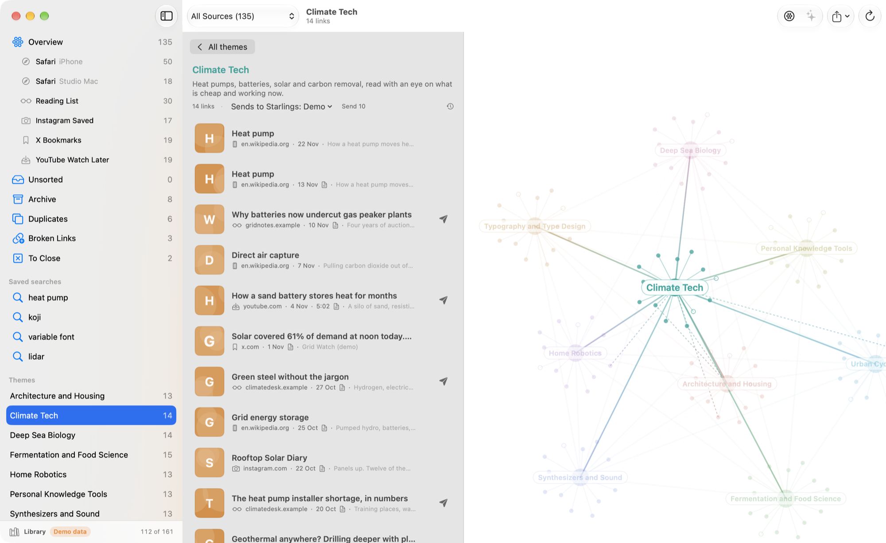
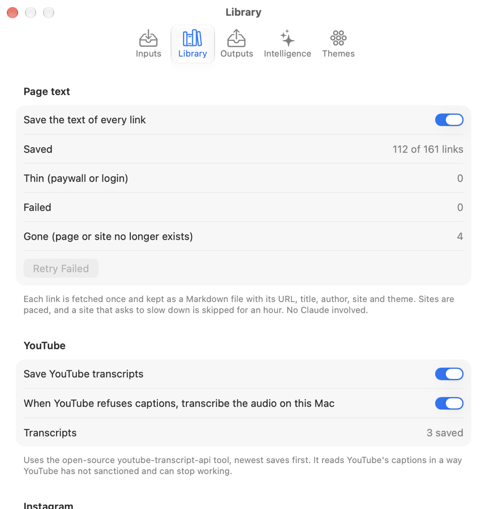

# Sift

A native macOS app for everything you saved "for later": open tabs on all
your devices, your Reading List, Instagram saves, X bookmarks and exports
from read-later tools.

Most of those links are not junk. Each one is a small promise to yourself:
this could matter. The browser keeps the link and forgets the promise. Sift
reads the pile back to you as the themes you keep coming back to, gives each
link an honest next step, keeps the text of every page in a library on your
Mac, and remembers what a link was about after the tab is gone.

The principle: your sprawl is not a problem to fix. It is a record of your
curiosity, and Sift makes it legible.

And it stays yours. Sift turns what you already save, on the platforms you
already use, into a knowledge base on your own Mac: the full text of pages,
video and reel transcripts, your notes and themes, in plain Markdown, JSON
and SQLite. No account, and your library never goes to a Sift server. Your own Claude can search it
through the built-in MCP server, and you can open every file without Sift.

<picture>
  <source media="(prefers-color-scheme: dark)" srcset="docs/images/overview-dark.png">
  
</picture>

<picture>
  <source media="(prefers-color-scheme: dark)" srcset="docs/images/theme-dark.png">
  
</picture>

Screenshots use Sift's demo mode and made-up sample data.

## What it does

### Sources

The source picker in the toolbar reads, all read-only:

- **Open tabs** that Safari syncs from your iPhone, iPad and other Macs
  through iCloud.
- **Safari's Reading List.**
- **Chrome tabs**, from every window of each Chrome profile where you add
  Sift's extension (Brave, Edge, Arc, Vivaldi and Chromium work too). See
  [Chrome](#chrome) below.
- **Instagram Saved**, from Instagram's data export. In Instagram's Accounts
  Center, open Download your information and ask for JSON (HTML does not
  work), then choose the zip in Settings > Inputs.
- **X Bookmarks**, with the optional X API connection.
- **Imported files**: File > Import Links File reads Instapaper and Pocket
  CSV, Readwise Reader and Raindrop CSV, Pinboard JSON, and the bookmarks
  HTML that browsers and most tools export. Sift finds the URL, title,
  folder or tags and date by name. Each file is its own source.
- **YouTube Watch Later and playlists**, from a Google Takeout export of
  "YouTube and YouTube Music" (the YouTube API cannot read Watch Later).
  Import the Takeout zip with File > Import Links File.
- **All Sources**: everything above together, each link once, newest first,
  with a small icon for where it came from.

### Themes

There is no folder structure to set up. **Discover Themes** sends every link
to your own Claude in one call and asks what you keep coming back to. You get
12 to 20 themes in Title Case, each with a description, the links behind it
and a suggested home. You rename, untick or accept them; nothing changes
before you do. Run it again later and Claude keeps the names that still fit,
so links do not reshuffle. There is one set of themes for every source.

New links that are in no theme yet show as a grey cluster, and a banner
always offers the next step: **Discover Themes Again** to read everything
together, or **Sort into Current Themes**, which is cheaper.

Tabs that are open for a task rather than out of curiosity (orders,
accounts, carts, searches, dashboards, documents being edited) go to an
**errands** bucket. Sift spots the clear ones by URL and never sends them to
Claude; they stay out of themes, the graph and exports. The other buckets
are personal, drop and unknown. You can move any link by hand, and Sift
never overwrites a choice you made.

### Graph

The overview is a graph that loads in place. Each theme is a node with its
links around it as dots, and lines join themes that draw on the same sources
(the same site, or posts that link to the same domain). Colors are spread
evenly around the color wheel for however many themes you have, at equal
lightness, in light and dark mode. Hover a theme and the others fade.

Click a theme and the camera glides onto it: its links appear as a list in a
panel on the left, with the cluster still in view. Pinch or two-finger scroll
to zoom the map. Esc or a click on empty space zooms back out.

### List and the browser

Links show as a list: thumbnail, title, source, date, what Sift saved and
one line of preview, then the theme and a send button. Click a link and the page opens in a browser that slides in over the
right side. ↑↓ move through the list; Space opens and closes the browser.
The browser has back, forward, reload, Open in Safari, Send and, for pages
in the library, a reader view of the saved text.

<picture>
  <source media="(prefers-color-scheme: dark)" srcset="docs/images/list-dark.png">
  
</picture>

### Send

A link stays in Sift until you send it where it will be used. Destinations:

| Destination | What a send does |
| ----------- | ---------------- |
| Starlings workspace | Saves the link to your Links in that workspace's Docs (Starlings reads the page and keeps title, image and description) |
| Obsidian folder | Writes one note per link: front matter, your note, summary, saved text |
| Markdown file | Adds one line per link at the end of the file |
| Reading List | Adds the link to Safari's Reading List |

Sending is immediate. Each theme can name a default destination: then one
click on the plane sends there, and the theme header can send all of its
links at once. A sent Safari tab goes on the iPhone close list. The sidebar
lists what went to each destination. Connect Starlings in Settings > Outputs:
Sift signs in like Claude Code (OAuth, no API key) and keeps the tokens in
the keychain. Destinations are plugins: one file per kind in `Sift/Send/`.

### Archive

Sift keeps a record of every link it has seen: title, theme, use,
preview and dates. When a link leaves its source (a tab closed on
the phone, an item removed from the Reading List or an export), the record
moves to **Archive** instead of being forgotten.

### Library

Sift saves the readable text of every link into a library on your Mac: one
Markdown file per link, with the URL, title, author, site, theme and date at
the top, in `~/Library/Application Support/Sift/Library/`. Articles keep
their headings, paragraphs and lists; PDFs keep their text; posts keep their
text (Instagram posts their caption); YouTube videos keep their title,
channel and full description, which usually includes the chapters. With the
open-source `youtube-transcript-api` tool installed (Settings > Library >
Install Transcript Tool, which needs Python 3), Sift also
saves each video's transcript, newest saves first. The tool reads YouTube's
captions in a way YouTube has not sanctioned, so it can stop working; Sift
paces it and pauses for an hour when YouTube refuses. Errands are skipped. Capture runs on
its own in the background, with a progress bar at the foot of the sidebar,
and does not use Claude. When a tab closes, its text stays.

### X posts

Without setup, X posts show their text through X's public oEmbed endpoint.
An opt-in setting uses X's embed data for images, avatars and the real URLs
behind t.co links (unofficial, may stop working).

With your own X developer app connected (optional, and X bills your
developer account per post read), Sift draws posts natively with no web
page: author, full text, images, video, quoted posts and links, following
X's display requirements. It reads posts in batches of 100, caches them,
refreshes a post only when its copy is older than a week, and drops posts
that X no longer returns. It can also bring in your 800 most recent
bookmarks.

To connect: create a Native App in the X Developer Console with callback URL
`http://127.0.0.1:53682/callback` and the scopes `tweet.read`, `users.read`,
`bookmark.read` and `offline.access`. Paste its Client ID in Settings >
Inputs > X and click Connect.

### Closing tabs on the iPhone

A Mac cannot close tabs on another device. Sift writes the tabs you mark to
`iCloud Drive/Sift/close.txt`, and a Shortcut on the iPhone closes them. The
ready-made Shortcut is one tap: [install "Sift: Close Tabs"](https://www.icloud.com/shortcuts/6afe4511e1064e4297e749b5b7e55290)
(Sift also shows it as a QR code). It splits the list by lines, and for each
address finds the tab, switches to it and closes it. iOS 17 or later.

### Chrome

Sift reads Chrome's open tabs through a small extension in
`ChromeExtension/` (Manifest V3, permissions `tabs` and `nativeMessaging`
only). The extension sends the address and title of each open tab to
`sift-chrome`, a helper inside Sift.app, through Chrome's native messaging.
The helper writes one file per profile to
`~/Library/Application Support/Sift/chrome/`. Nothing goes over the
network. Each profile is its own source; one that has not reported for a
day shows as stale.

Chrome is on the same Mac, so Sift closes Chrome tabs itself: a tab you mark
to close goes to `chrome/close.json`, and the extension closes it within a
minute while Chrome runs.

To set it up: Settings > Inputs > Chrome > Install Chrome Helper (or the
Chrome step of the Setup Guide). Sift writes the helper's manifest for each
Chromium browser it finds, copies the extension to
`~/Library/Application Support/Sift/ChromeExtension` and shows it in Finder.
Then open `chrome://extensions`, turn on Developer mode, click Load unpacked
and choose that folder. The extension is not in the Chrome Web Store yet.

### Export

The Export menu writes your themes and links out:

| Exporter | What you get |
| --- | --- |
| Obsidian Vault | One note per link and per theme with front matter and [[wikilinks]], so Obsidian's graph view shows themes as hubs. Your text under "## Notes" survives re-exports. |
| Markdown File | One file, a section per theme |
| Copy as Markdown | The same, on the clipboard |
| CSV File | One row per link; File > Import Sorted CSV reads it back |
| JSON File | The full snapshot, for scripts |

Each exporter is one Swift file. Adding one is the easiest way to
contribute; see [CONTRIBUTING.md](CONTRIBUTING.md).

### What Sift sends where

- **To Claude**, through your Claude Code login or your own API key: for
  theme discovery and sorting, each link's title, URL and short
  preview text, plus your theme names. Never whole pages. Errands never go
  to Claude.
- **To Apple's on-device model**, which runs on this Mac: the same title,
  URL and preview for sorting, and saved page text for summaries. Nothing
  leaves the Mac.
- **To each site**, once: a request for its page, for the preview and the
  library. X posts go to X's oEmbed endpoint, and to its embed data or API
  only if you turn those on.
- **To Sift's diagnostics**, once a week: an anonymous report with the app
  and macOS version, which kinds of source and destination you use, which
  switches are on, and rough sizes such as "100-999 links". No link, title,
  theme name, note or install id. It is on by default; Settings > Privacy
  turns it off and shows the exact report.
  [Privacy contract](docs/telemetry.md) ·
  [Community Pulse](https://sift-telemetry.envisioning.workers.dev/community)
- **Nowhere else.** Sift has no account. It reads Safari's
  files and never writes to them. Add to Reading List asks Safari through its
  own scripting command, and macOS asks you to allow that once.

## Requirements

- macOS 14 (Sonoma) or later
- Full Disk Access, to read Safari's synced tabs and Reading List
- One of: [Claude Code](https://claude.com/claude-code) signed in (the
  default; Sift runs `claude -p` with tools, MCP servers and settings turned
  off), or an Anthropic API key in your keychain
- Optional: iCloud Tabs on, for tabs from other devices
- Optional: macOS 26 or later with Apple Intelligence on, for sorting and
  summaries on this Mac

## Install

Download the latest `Sift-x.y.z.zip` from
[Releases](https://github.com/michellzappa/sift/releases), unzip it and move
Sift to Applications. Releases are signed with a Developer ID, notarized by
Apple, and carry a build provenance attestation. To check that a download
came from this repository's release workflow:

```sh
gh attestation verify Sift-0.5.0.zip -R michellzappa/sift
```

Each release also has a `SHA256SUMS` file.

### First run

On first launch Sift opens the Setup Guide: Welcome, Sources, Chrome, Claude,
Library, Themes, Send and a few tips. Only Welcome is required. Sources
is where you turn on Full Disk Access for Safari's tabs and Reading List.
macOS does not list the app until you add it: in System Settings, open
Privacy & Security, then Full Disk Access, click +, and choose Sift. Sift
checks again when you come back. Themes runs Discover Themes, and after you
accept the themes, the graph is ready. Help > Setup Guide opens the guide
again at any time. When an update adds a step, Sift shows only that step,
once.

### Build it yourself

```sh
./scripts/build-app.sh      # builds, signs and copies to /Applications/Sift.app
```

You need Xcode and `xcodegen`. Set your own `DEVELOPMENT_TEAM` in
`project.yml` first. The build number is the git commit count.

`project.yml` signs with an Apple Development identity, not ad hoc, because
macOS ties the Full Disk Access grant to the code signature: an ad hoc build
loses the grant on every rebuild. Set `SIGN_IDENTITY` to use another
identity. The app icon comes from the `sift` glyph in HouseKit, the small
package Sift shares with Tessellate, Cargo and Clip; without HouseKit next to
this repo, the script uses the committed `AppIcon.icns`.

### Demo mode

Start Sift with `-demo` (or `SIFT_DEMO=1`) to run it on made-up sample
data instead of your own:

```sh
open -n -a /Applications/Sift.app --args -demo
```

Demo mode keeps every file in `~/Library/Application Support/Sift-Demo` and
replaces that folder with the sample data on each launch, so every run starts
the same. It never reads your Safari tabs, Reading List, Instagram export,
Chrome, X account or keychain, and it never goes online: no previews,
capture, transcripts, Claude, on-device model or Starlings. Sending a link
only records it as sent. A "Demo data" badge sits at the foot of the
sidebar.

The sample data is in `Demo/`, made by `python3 scripts/demo/make-data.py`
from `scripts/demo/content.py` (thumbnails by
`scripts/demo/make-images.swift`).

The README screenshots come from demo mode only. With Sift installed in
`/Applications` and Screen Recording allowed for your terminal, run:

```sh
scripts/screenshots.sh
```

It quits Sift, opens it in demo mode once per view and appearance, and
writes `docs/images/<view>-light.png` and `<view>-dark.png` (overview,
theme, list, settings-library, settings-outputs).

### Releases

Push a tag that matches `CFBundleShortVersionString`, for example `v0.5.0`.
The workflow in `.github/workflows/release.yml` builds a universal app,
signs it with Developer ID, notarizes and staples it, attests its provenance,
and publishes the ZIP and `SHA256SUMS`. It needs these repository secrets:
`APPLE_TEAM_ID`, `APPLE_DEVELOPER_CERTIFICATE_P12_BASE64`,
`APPLE_DEVELOPER_CERTIFICATE_PASSWORD`, `APPLE_API_KEY_ID`,
`APPLE_API_ISSUER_ID` and `APPLE_API_PRIVATE_KEY_BASE64`.

## Settings

<picture>
  <source media="(prefers-color-scheme: dark)" srcset="docs/images/settings-library-dark.png">
  
</picture>

<picture>
  <source media="(prefers-color-scheme: dark)" srcset="docs/images/settings-outputs-dark.png">
  
</picture>

**Inputs** lists every source with its status and actions: Safari tabs
(devices and tab counts, the tab database, Full Disk Access), the Reading
List, the Instagram export, X (preview options and the optional X API
connection with Sync Bookmarks) and imported link files.

**Library** controls what Sift saves on this Mac. Each kind has its own
switch and counts: page text (saved, thin and failed, with Retry Failed),
YouTube transcripts (with Install Transcript Tool), Instagram post images,
and what Instagram reels say (with Install Reel Tool: the open-source
`yt-dlp` fetches each reel's audio without a login, one every 4 seconds,
macOS speech recognition turns it into text, on the Mac where the language
allows, and the audio is deleted). It shows progress while each runs, the size on disk, and Show
Library in Finder.

**Search** works in every list: the filter field searches titles, saved
page text and transcripts (SQLite full-text index on this Mac).

**Claude can read your library.** Sift ships a small MCP server,
`sift-mcp`. Settings > Intelligence > Add to Claude Code runs
`claude mcp add --scope user sift -- /Applications/Sift.app/Contents/MacOS/sift-mcp`.
Claude can then search your links, page text and transcripts, list your
themes and read a link in full. It only reads Sift's index.

**Upkeep.** Duplicates (the same page from two sources, or with tracking
parameters) show under Duplicates, with Merge All. Pages that are gone
(not found, or the site no longer exists) show under Broken Links; Sift
keeps what it saved. Each link can carry your own note (right-click > Add
Note), which search and Claude see. Any search can be saved to the sidebar.

**Theme memory.** Each theme keeps a dated history (found, renamed,
rediscovered with how many links), and the theme header picks where its
links are sent.

**Connections.** After sorting, Claude marks links that feed a second
theme. The graph pulls those themes closer and draws a dashed line from the
link to the other theme.

**Outputs** runs each exporter and shows its last folder or file, shows the
iPhone close list and the Shortcut guide, and explains Add to Reading List
(Safari asks once for Automation permission).

**Claude** chooses Claude Code or an API key (`claude-opus-5-5` at low
effort) and stores the key in the keychain.

**On this Mac.** On macOS 26 or later with Apple Intelligence on, Apple's
on-device model does part of Claude's work, for free and offline. When you
sort, it looks at each new link first. Errands and noise it is sure about go
straight to their buckets, and a link that clearly fits one of your themes
goes there. Claude sorts the rest. After a page or transcript is saved, the
model writes a one-paragraph summary into the library file and the search
index, and `sift-mcp` returns it. Summaries run one at a time, newest first,
and wait while the Mac runs on battery. Settings > Intelligence > On this Mac has a
switch for each feature, says whether the model is available, and counts the
links each model sorted. On older Macs, Claude does all of it as before.

**Themes** lists your themes. You can rename or delete one, add one by hand,
or run Discover Themes again.

## Architecture

About 5,500 lines of SwiftUI. No dependencies.

| | |
| --- | --- |
| `Storage/CloudTabsReader` | Safari's synced tabs (`CloudTabs.db`, SQLite, read-only) |
| `Storage/ReadingListReader`, `InstagramReader`, `LinkImporter` | The other sources |
| `Storage/ChromeReader`, `ChromeHelper` | Chrome tabs from the extension, and the helper setup |
| `SiftChrome/` | `sift-chrome`, Chrome's native messaging host (embedded in the app) |
| `ChromeExtension/` | The Chrome extension (plain JavaScript, no build step) |
| `Storage/Previews` | Page previews (Open Graph, X oEmbed and embed data) and the iPhone close list |
| `Storage/Archive` | Every link Sift has seen, and what it knows about it |
| `Storage/StateFile` | Settings, themes and assignments, as one JSON file |
| `Engine/Capture` | Page capture, text extraction and the Markdown library |
| `Engine/LocalModel` | Apple's on-device model: first pass, theme picks and summaries |
| `Send/*` | Destinations: Starlings (OAuth + MCP), Obsidian, Markdown, Reading List |
| `Sorting/Sorter` | Theme discovery and sorting through `claude -p` or the Messages API |
| `Sorting/Errands` | Rules for transactional tabs |
| `X/*` | Optional X API: sign-in, client, cache and the native post view |
| `Export/*` | The exporter protocol, the registry and one file per exporter |
| `Views/*` | Sidebar, graph, list, browser pane, theme review, settings |

Swift has no official Anthropic SDK, so the API backend uses plain HTTP.

## Limitations

- Sift cannot close Safari tabs from the Mac; closing goes through the
  iPhone Shortcut. Chrome tabs close directly.
- Sift cannot remove items from the Reading List or from imported files.
- Pages behind a login have no preview and only thin text in the library.
- Instagram posts show the caption from your export, not the image.
- One link belongs to one theme.

## License

MIT. See [LICENSE](LICENSE).
