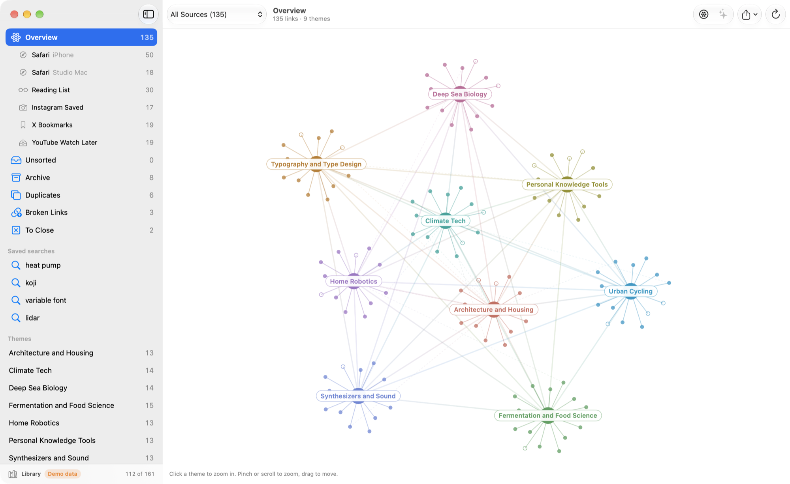
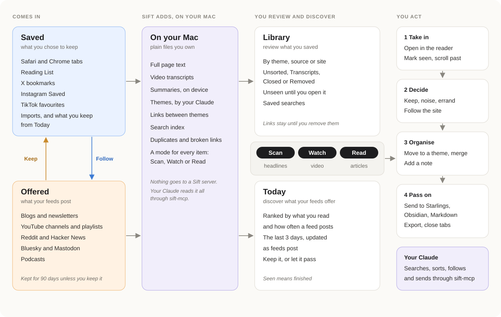
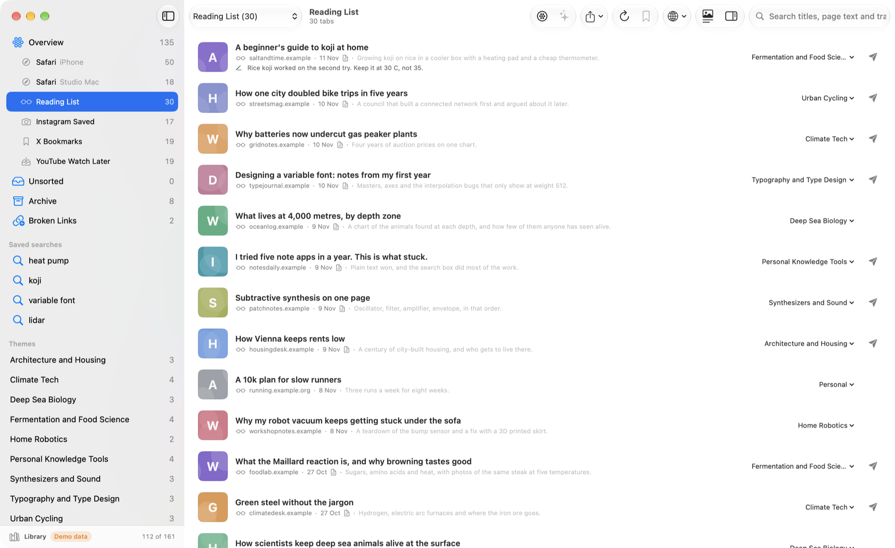
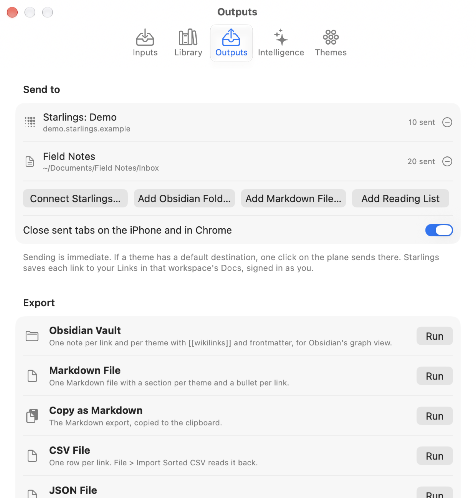

# Sift

Sift is a multisocial reader for heavy readers, on the Mac and the iPhone.
It reads what you save and follow on the networks you already use: Safari
tabs, Reading List, Instagram, TikTok, X, YouTube, feeds, Bluesky and
Mastodon. It keeps the full text of pages and the transcripts of videos in
a library on your Mac. It groups your links into themes with your own
Claude. Every day it ranks a short Today from your feeds, and every pick
says why it is there.

Your data stays on your Mac. The library is plain Markdown, JSON and
SQLite, and you can open every file without Sift. Sift has no account and
no Sift server ever sees your links, titles, text, themes or notes. Sift
reads Instagram, TikTok and X only from the exports you download. It never
logs in to them and never uses browser cookies. Your own Claude can search
the library and work on it through the built-in MCP server.

**Contents:** [Install](#install) · [How it fits together](#how-it-fits-together) ·
[Inputs](#inputs) · [Today](#today) · [The library](#the-library) ·
[Your Graph](#your-graph) · [The reader](#the-reader) ·
[Send and export](#send-and-export) · [The iPhone app](#the-iphone-app) ·
[Where AI is used](#where-ai-is-used) · [Claude and sift-mcp](#claude-and-sift-mcp) ·
[What leaves your Mac](#what-leaves-your-mac) · [Settings](#settings) ·
[Keyboard](#keyboard) · [Build it yourself](#build-it-yourself) ·
[Limitations](#limitations) · [More docs](#more-docs)

<picture>
  <source media="(prefers-color-scheme: dark)" srcset="docs/images/overview-dark.png">
  
</picture>

<picture>
  <source media="(prefers-color-scheme: dark)" srcset="docs/images/theme-dark.png">
  
</picture>

These screenshots come from Sift's demo mode and made-up sample data.

## Install

### Mac

Download the latest `Sift-x.y.z.zip` from
[Releases](https://github.com/michellzappa/sift/releases), unzip it and move
Sift to Applications. The release workflow signs each release with a
Developer ID, has Apple notarize it and attests its build provenance. To
check that a download came from that workflow:

```sh
gh attestation verify Sift-1.8.9.zip -R michellzappa/sift
```

Each release also has a `SHA256SUMS` file.

You need macOS 14 (Sonoma) or later, and one of these for themes:

- [Claude Code](https://claude.com/claude-code), signed in. This is the
  default. Sift runs `claude -p` with tools, MCP servers and settings turned
  off.
- An Anthropic API key, kept in your keychain.

Safari's synced tabs and the Reading List need Full Disk Access. Sorting
and summaries on this Mac need macOS 26 or later with Apple Intelligence
on. Without it, Claude does that work.

Sift updates itself with Sparkle. When a new version is out, "Update to X"
shows in the toolbar and in Settings > General. Sift > Check for Updates…
asks at once. Sift > Version History… shows the changelog.

### iPhone

The iPhone app, "Sift: Scan, Watch, Read", is on TestFlight:
[testflight.apple.com/join/183k9bZC](https://testflight.apple.com/join/183k9bZC).
It needs iOS 17 or later and Sift on your Mac. The Mac does all the
fetching and writes what the phone shows to the Sift folder in iCloud
Drive.

### First run

On first launch Sift opens the Setup Guide: Welcome, Sources, Chrome,
Claude, Library, Themes, Send and a few tips. Only Welcome is required.
Sources is where you turn on Full Disk Access. macOS does not list the app
until you add it: in System Settings, open Privacy & Security, then Full
Disk Access, click + and choose Sift. Themes runs Discover Themes. After
you accept the themes, the graph is ready. Help > Setup Guide opens the
guide again. When an update adds a step, Sift shows only that step, once.

## How it fits together



Sift has two kinds of input:

- Saved links are what you chose: tabs, Reading List, bookmarks,
  Instagram and TikTok saves, X bookmarks, your own YouTube playlists,
  imports. They stay until you remove them. You review them in the
  Library.
- Offered items are what your feeds post. They show only in Today and in
  each feed's own list, never in your themes. Sift keeps them for 90 days.

Keep moves an offered item into your saved links. Follow subscribes to the
site or account behind a saved link. Both the Library and Today have the
same Scan, Watch and Read switch. Settings > How It Works shows this
diagram.

## Inputs

Sift reads every saved source read-only.

- Open tabs that Safari syncs from your iPhone, iPad and other Macs through
  iCloud.
- Safari's Reading List.
- Chrome tabs, from each Chrome profile where you add Sift's extension.
  Brave, Edge, Arc, Vivaldi and Chromium work too. See [Chrome](#chrome).
- Instagram Saved, from Instagram's data export. In Instagram's Accounts
  Center, open Download your information and ask for JSON (HTML does not
  work). Then choose the zip in Settings > Inputs. Saves are titled
  "Name (@user)".
- TikTok favourites, from TikTok's data export, and your liked videos if
  you turn that on. In TikTok, open Settings and privacy > Account >
  Download your data and ask for JSON. Then choose the zip in Settings >
  Inputs. Sift reads each video's caption, author and cover from its public
  page and does not sign in.
- X bookmarks, with the optional X API connection. See [X posts](#x-posts).
- YouTube Watch Later and playlists from a Google Takeout export of
  "YouTube and YouTube Music". Import the zip with File > Import Links File.
- Your own YouTube playlists as live lists. YouTube's Watch Later is
  private, so make a public or unlisted playlist, add videos to it from any
  device and paste its link into Follow. Add to Library makes it a Library
  source like Reading List. A video you take out of the playlist moves to
  Closed or Removed. Sift reads the first 100 videos, not only the 15 that
  YouTube's playlist feed holds. Move to Library as My List and Show in
  Today Instead, in a feed's menu, switch any feed between the two.
- Imported files: File > Import Links File reads Instapaper and Pocket CSV,
  Readwise Reader and Raindrop CSV, Pinboard JSON and the bookmarks HTML
  that browsers export. Each file is its own source.
- Kept from Today: the feed items you kept.
- All Sources: every saved source together, each link once, newest first.

### Feeds

Follow (the + in the toolbar, Shift-Command-N, the A key or File >
Follow…) takes almost anything: a site, a feed address, a Substack,
`r/subreddit`, `@name.bsky.social`, `@user@mastodon.social`,
`#tag@instance`, a YouTube channel or playlist, `podcast: name`,
`owner/repo` on GitHub, a Medium or Tumblr address, `hn` or `hn: words`,
`news: words`, `arxiv cs.AI`. It starts from an address on the clipboard,
finds the feed while you type, and shows how often it posts and its newest
titles. You pick a folder and the feed's priority in Today before you
follow. You can drop a link or an OPML file on the sheet or on the
sidebar's Feeds section. "Follow <site>" is in every link's context menu (F
key). Sift suggests sites, subreddits and repositories that you save often.
`feed://` and `sift://subscribe?url=` links open in Sift. Each kind of
input is a small provider plugin ([CONTRIBUTING.md](CONTRIBUTING.md)).

Settings > Inputs > Feeds imports OPML (all feeds, or the ones you pick)
and exports it for any other reader. The sidebar lists feeds and folders.
Drag a feed onto a folder, or use Move to Folder in its menu. Counts show
items held. Sift shows no unread counts.

### Who you follow

Settings > Inputs > Who you follow reads the accounts you follow on every
network:

- YouTube subscriptions from your Google Takeout export.
- Instagram and TikTok following lists from their exports.
- The accounts you follow in your X archive.
- Bluesky and Mastodon follows, from your handle.

YouTube, Bluesky and Mastodon accounts become feeds in their own folders
("YouTube subscriptions", "Bluesky follows", "Mastodon follows"). Instagram,
TikTok and X accounts have no feed. They join People in Your Graph, so Sift
can match them with the same person's site or newsletter.

### Downloads watching

Exports go stale, and Instagram, TikTok and X posts reach Sift only as
fast as you export them. When you turn on Watch Downloads, Sift notices a
new Instagram, TikTok, X or YouTube export in your Downloads folder, copies
it and reads it. It never moves or deletes the file in Downloads. Once a
month Sift reminds you when an export is older than 30 days, with the steps
to make a new one.

## Today

Today is the digest of what your feeds offer. It ranks on your Mac and
never calls Claude. It has no fixed size: after each feed check, new picks
go on top and the ones you already have keep their place. An item leaves
Today after three days unless you keep it, so it never becomes a pile.

[How Sift ranks](docs/how-sift-ranks.md) explains the ranking in words and
gives every number.

### Themes first

Today shows its picks in sections by theme, each in the theme's colour.
Every pick has a small badge for its network: YouTube, Bluesky, Reddit,
Hacker News, a blog and so on. The theme is the headline and the network is
a detail. Group by Theme in the toolbar turns the sections off.

### Scan, Watch, Read

The switch at the top of every list (Today, a feed, a folder, a source, a
theme) shows one way of taking things in. The keys are 0 (All), 1, 2 and 3.

- Scan shows headlines and posts as short rows without pictures: Hacker
  News, Reddit, X, Bluesky and Mastodon. A row you scroll past counts as
  seen. Hacker News and Reddit items show their top three comments.
- Watch shows videos as cards with their length: YouTube, Shorts, TikTok,
  Instagram reels and Vimeo. Shorts, TikToks and reels are tall cards.
- Read shows blogs, newsletters and articles of any length, with the
  reading time and three lines of the summary.

Sift gives each item a mode from its link and its feed. Mode, in a feed's
menu, sets it for every item of that feed. Each mode gets at least five
picks in Today when there are enough. On a quiet day for your video feeds,
older videos fill Watch.

### Why this is here

Every pick has a reason line: "Hot in 3 of your feeds", "Fits <theme>",
"You saved 14 from <creator>", "Linked by <feed>", "New to you",
"Something different", "Trying for <theme>". Under "Why this is here" you
see the rule that gave the pick its place and every number of its score.
How Today Works (the ? in Today's toolbar) shows the rules and each feed's
standing. Settings > Algorithm shows the formula with live numbers.

### Controls

- Feed priority: Auto, Don't Miss, Normal, Best Only or Not in Today. Auto
  makes a feed with more than five posts a day Best Only.
- Network dials: More, Normal, Less or Off for each network, in Today's
  toolbar, Settings > Algorithm and the iPhone's Settings. Beside each dial,
  Sift shows what it learned from what you open, keep and skip.
- Theme dials: Stay, Lean In or Explore for each theme, in the theme's
  header or its sidebar menu. Lean In doubles the theme's lift and tries up
  to two creators you save from there. Explore tries up to three sources
  one step out.
- Tried sources: a source that a theme dial tries is not a follow. Its
  items say "Trying for <theme>". Follow or Stop sits above each of its
  items. It goes after two weeks unless you follow it, and a keep gives it
  two more weeks.
- Not Interested, in each pick's menu: less from this source, less about
  this theme for 30 days, or seen enough of this story for a week.
- Snooze Discovery, in Today's toolbar: for a week, only your feeds' own
  picks. No "Linked by" places, "New to you", "Something different" or
  tried sources.
- Forget What Sift Learned, in a feed's menu: what you did with its items
  no longer counts.

### Keeping and opening

An item opens as text first, like a reader app: the feed's full text, or
the article that Sift fetches once and keeps. The Reader/Page switch shows
the web page. Links inside open in Sift's own browser window, not in
Safari, so they do not come back as tabs. Keep (S, the context menu or the
button above the page) moves an item into Kept from Today and your library.

On Bluesky and Mastodon you can Like and Save from the reader once you
sign in under Settings > Inputs (Bluesky with an app password, Mastodon
through your instance). These are the only accounts Sift signs in to.
Instagram, TikTok, X and YouTube items have Open in <app>.

### Lanes

A lane is a saved rule over your feed items, with its own place under Feeds
in the sidebar. It matches words, a folder, a theme or a mode, shows the
last two weeks unseen first, and ends after 60 items. New Lane… is in the
sidebar. The editor counts the matches while you type.

## The library

Sift saves the readable text of every saved link into a library on your
Mac: one Markdown file per link, with the URL, title, author, site, theme
and date at the top, in `~/Library/Application Support/Sift/Library/`.
Articles keep their headings, paragraphs and lists. PDFs keep their text.
Posts keep their text, and Instagram posts and TikTok videos their caption.
YouTube videos keep their title, channel and description. Capture runs in
the background and does not use Claude. When a tab closes, its text stays.

Transcripts are optional:

- YouTube: install the open-source `youtube-transcript-api` tool in
  Settings > Library (it needs Python 3). It reads YouTube's captions in a
  way YouTube has not sanctioned, so it can stop working. Sift paces it and
  pauses for an hour when YouTube refuses.
- Instagram reels, TikTok videos, and YouTube videos without captions: the
  open-source `yt-dlp` fetches the audio without a login or cookies, macOS
  speech recognition writes it down, and Sift deletes the audio.

The sidebar's Transcripts list shows every link with a transcript. When a
site refuses requests, its job waits (one hour, doubling up to a day) and
the sidebar footer says until when.

### Themes

There is no folder structure to set up. Discover Themes sends every link's
title, address and preview to your own Claude in one call and asks what
you keep coming back to. You get themes with a description and the links
behind them. You rename, untick or accept them. Nothing changes before you
do. A rerun keeps the names that still fit, so links do not reshuffle.

New links that are in no theme yet show as a grey cluster. The box at the
foot of the sidebar counts them and has a Sort menu:

- Sort into Themes files new links into the themes you have. Apple's
  on-device model, when the Mac has it, tries each link first. Claude
  sorts the rest.
- New Themes from Unsorted proposes themes for the links that fit none of
  yours. Your themes stay as they are.
- Discover Themes Again rebuilds the whole set.

Merge Into, in a theme's menu or Settings > Themes, joins two themes. Every
link, hand moves included, and the theme's history move to the theme you
keep. Tabs that are open for a task (orders, carts, accounts, dashboards)
go to an errands bucket. Sift spots the clear ones by address and never
sends those to Claude. You can move any
link by hand, and Sift never overwrites a choice you made.

Each theme shows:

- Terms: the words that set it apart from your other themes, counted on
  your Mac from its links' titles and previews.
- Parts: a larger theme splits into two to five parts by meaning. Apple's
  on-device model names them. A click on a part shows only its links.
- A pill per mode (Scan, Watch, Read) under its name in the sidebar, with
  what is unseen.
- A dated history: found, renamed, merged, rediscovered.

### The graph

The overview is a graph. Each theme is a hub with its links around it,
newest nearest the hub. A solid dot means Sift saved the text or a
transcript; a ring means title only. Lines join themes that share sites or
links. Click a theme and its links show in a panel on the left with the
cluster still in view. Esc zooms back out.

### Trails

More Like This (T, or the context menu) on any item opens a trail: up to 20
unseen items near it, from your saves and the last two weeks of your feeds.
Sift scores the same creator, the same theme, shared words and closeness in
meaning. The trail ends. Start a new one from any item on it.

### Search and upkeep

The filter field in every list searches titles, saved text, transcripts and
summaries through a SQLite full-text index on your Mac. You can save a
search to the sidebar. Duplicates (the same page from two sources, or with
tracking parameters) show under Duplicates, with Merge All. Pages that are
gone show under Broken Links; Sift keeps what it saved. Each link can carry
your own note (Add Note in its menu), which search and Claude see.

A link is unseen until you open it, mark it (M) or scroll past it in Scan.
Theme counts in the sidebar are unseen counts. Each list has Unseen Only
and Mark All as Seen. Seen marks sync with the iPhone through iCloud Drive,
one file per device, so there are no conflicts.

When a link leaves its source (a tab closed, an item removed from an
export), Sift moves its record to Closed or Removed instead of forgetting
it.

## Your Graph

Your Graph, in the sidebar under Feeds, is the social graph behind what
you save. Sift only proposes. Nothing from it reaches Today until you
follow it.

- Creators: the YouTube channels, sites, writers, subreddits and
  repositories behind your saves, ranked by your saves (a save counts half
  after 90 days). The people behind your X, Instagram and TikTok saves are
  here too. They have no feed, so their profile opens instead. Each creator
  shows its themes, your saves, how the score adds up, and the creators
  close to it: close in meaning, or saved in the same theme in the same
  week. A graph rank shows how central a creator is to the ones you follow.
  A followed creator gets a lift in Today by how many of its links you
  saved.
- Next Door: creators outside your graph that two or more of yours link
  to, found in the pages, video descriptions and feed items that Sift
  already has. Sponsor links, shops, tip jars and a creator's own site do
  not count.
- Farther: pick a theme and ask your own Claude where it goes next. Claude
  names sources one step beyond what you follow: deeper, a neighbouring
  field and one serious different view. Sift checks each for a feed, and
  only those with a feed can be followed. "What Claude saw" shows the exact
  text sent.
- People: one person, every place they publish (site, YouTube, Bluesky,
  Mastodon, newsletter, podcast, GitHub, and links to X, Instagram, TikTok,
  Threads and LinkedIn). Sift finds them only from what each person
  publishes about themselves: rel=me links, the profiles their own site or
  YouTube channel links to, and a Bluesky handle that is their domain.
  Follow Everywhere follows each place that has a feed. Not One Person
  splits a wrong group for good. A person's post on several platforms shows
  once in Today.

### The directory

The directory, first in the Follow sheet, lists who the people you follow
vouch for, small web first:

- blogrolls on the sites you follow;
- Substack recommendations from your newsletters;
- Bluesky's suggestions for the accounts you follow (only people with their
  own site), and Bluesky accounts that two or more of the accounts you
  follow also follow;
- Mastodon featured profiles;
- lists you watch: a FeedLand name or any OPML list;
- Kagi's Small Web list of personal blogs, matched on your Mac against the
  sites you save from and the sites your feeds link to.

Each name shows who vouches for it. The list ends: at most 12 per group,
once a week, only feeds that posted in the last 30 days. A feed you follow
from the directory gets a small lift in Today for 30 days. Theme searches
are off by default. When you turn them on, Sift sends the names of your six
biggest themes to Bluesky (starter packs), Apple Podcasts, Hacker News
search and ooh.directory.

## The reader

Text sits in one column of about 68 characters, in New York serif by
default, with a large title and a line with the site, author, date and
reading time. Quotes, code, lists and pictures have their own simple
styles. The Aa button sets the size (five steps) and serif or sans; both
apps remember it. On the Mac, Command-plus and Command-minus change the
size. Light and dark follow the system.

X posts show as posts: name, handle, date, text, links and pictures, with
Open on X. Instagram posts and reels and TikTok videos play in the pane
beside the list through their embed pages, without a login wall. Saved
pages and transcripts open on the saved text, and a switch shows the live
page.

Links show as rows: thumbnail, title, source, date, what Sift saved and a
line of preview. Rows have no buttons. Send, Follow, Copy, Add Note and the
rest are in the context menu and above the open page. Drag the divider to
set the pane's width.

<picture>
  <source media="(prefers-color-scheme: dark)" srcset="docs/images/list-dark.png">
  
</picture>

### X posts

Without setup, X posts show their text through X's public oEmbed endpoint.
Sift never reads x.com pages. An opt-in setting uses X's embed data for
images, avatars and the real addresses behind t.co links. It is unofficial
and can stop working.

With your own X developer app connected (optional, and X bills your
developer account per post read), Sift draws posts with author, full text,
images, video, quoted posts and links. It can also bring in your 800 most
recent bookmarks. To connect, create a Native App in the X Developer
Console with callback URL `http://127.0.0.1:53682/callback` and the scopes
`tweet.read`, `users.read`, `bookmark.read` and `offline.access`. Paste its
Client ID in Settings > Inputs > X and click Connect.

### Chrome

Sift reads Chrome's open tabs through a small extension in
`ChromeExtension/` (Manifest V3, permissions `tabs` and `nativeMessaging`
only). The extension sends the address and title of each open tab to
`sift-chrome`, a helper inside Sift.app. The helper writes one file per
profile to `~/Library/Application Support/Sift/chrome/`. Nothing goes over
the network. A tab you mark to close goes to `chrome/close.json`, and the
extension closes it within a minute.

To set it up, open Settings > Inputs > Chrome > Install Chrome Helper. Sift
copies the extension to `~/Library/Application Support/Sift/ChromeExtension`
and shows it in Finder. Then open `chrome://extensions`, turn on Developer
mode, click Load unpacked and choose that folder. The extension is not in
the Chrome Web Store.

### Closing tabs on the iPhone

A Mac cannot close tabs on another device. Sift writes the tabs you mark to
`iCloud Drive/Sift/close.txt`, and a Shortcut on the iPhone closes them:
[install "Sift: Close Tabs"](https://www.icloud.com/shortcuts/6afe4511e1064e4297e749b5b7e55290)
(Sift also shows it as a QR code). iOS 17 or later.

## Send and export

A link stays in Sift until you send it where you use it:

| Destination | What a send does |
| --- | --- |
| Starlings workspace | Saves the link to your Links in that workspace's Docs |
| Obsidian folder | Writes one note per link: front matter, your note, summary, saved text |
| Markdown file | Adds one line per link at the end of the file |
| Reading List | Adds the link to Safari's Reading List |

Sending is immediate. Each theme can name a default destination: then E,
or Send in the context menu, sends there. A sent Safari tab goes on the
iPhone close list. Connect Starlings in Settings > Outputs. Sift signs in
with OAuth and keeps the tokens in the keychain.

The Export menu writes your themes and links out:

| Exporter | What you get |
| --- | --- |
| Obsidian Vault | One note per link and per theme with [[wikilinks]]. Your text under "## Notes" survives re-exports. |
| Markdown File | One file, a section per theme |
| Copy as Markdown | The same, on the clipboard |
| CSV File | One row per link; File > Import Sorted CSV reads it back |
| JSON File | The full snapshot, for scripts |

Destinations and exporters are plugins, one Swift file each. See
[CONTRIBUTING.md](CONTRIBUTING.md).

## The iPhone app

The iPhone app shares Sift's folder in iCloud Drive. Its tabs are Scan,
Watch, Read and Themes.

- Scan is Today's headlines, in theme sections, with Hacker News and
  Reddit comments. It holds only Today: Scan is for browsing, not saving.
- Watch is full-screen video cards, Today's picks first and then your
  saved videos. YouTube plays muted on screen and a tap turns the sound on.
  Instagram and TikTok play in the system player. Turn the phone for full
  screen. Each card shows its theme and network, and has Keep and Not
  Interested.
- Read is articles in theme sections, Today first and then your saves,
  with the reading time. A tap opens the reader, with a thin bar that shows
  how far you have read.
- Themes is the interest graph, then your themes with unseen counts per
  mode. A theme page shows what is in Today, a shelf per mode, its terms,
  parts and dial, Next Door, Farther and who you save from. Its menu has
  the Review Deck, Feeds, Lanes, Your Graph, People and the directory.

Settings on the phone has the network dials, How Today Works, and What
Sift Knows About You. Follows, keeps, seen marks, dials and reading signals
go back to the Mac through files in `iCloud Drive/Sift`. The Mac does all
the fetching. The phone does not sign in to Bluesky or Mastodon.

## Where AI is used

- Your own Claude, through your Claude Code login or your API key: finding
  themes, sorting links that the on-device model is not sure of,
  connections between themes, and Farther when you ask. It gets titles,
  addresses and short previews, never whole pages. Errands that Sift
  spots by address never go to Claude.
- Apple's on-device model (macOS 26 or later with Apple Intelligence on):
  the first sorting pass, a one-paragraph summary of each saved page or
  transcript, and the names of theme parts. It runs on your Mac. Summaries
  wait while the Mac runs on battery.
- Apple's on-device embeddings (NaturalLanguage, part of macOS and iOS):
  closeness in meaning for trails, Today's theme fit, theme parts, the
  creator graph and the directory. The vectors are plain files in the
  embeddings folder.
- No AI: Today's ranking formula, Your Graph scores, Next Door, People,
  the directory's walk, Scan, Watch and Read, duplicates and search.

Settings > Intelligence chooses Claude Code or an API key
(`claude-opus-5-5` at low effort), has a switch for each on-device feature,
and counts the links each model sorted.

## Claude and sift-mcp

Sift ships an MCP server, `sift-mcp`, so your own Claude can use your
library. Settings > Intelligence > Add to Claude Code runs
`claude mcp add --scope user sift -- /Applications/Sift.app/Contents/MacOS/sift-mcp`.

- Claude can read: it searches titles, page text, transcripts and
  summaries, lists themes and their links, reads a link in full, and reads
  Today and your feeds.
- Claude can act: it merges and renames themes, files a link, adds a note,
  sorts, proposes and applies new themes, follows and unfollows feeds, sets
  a feed's priority, marks links seen, keeps and sends. `sift-mcp` never
  writes Sift's files itself. It leaves a request that the running app
  carries out, the same way a button does. Settings > Intelligence lists
  Claude's recent actions.

[Claude tools (sift-mcp)](docs/mcp.md) lists every tool and its arguments.

## What leaves your Mac

Nothing about your library goes to a Sift server. These requests leave the
Mac:

- To Claude, through your login or key: titles, addresses, short previews
  and theme names, for themes and sorting. Farther sends one theme's name,
  summary, history, newest titles and creators, and shows you the exact
  text.
- To each site: one request for its page, for the preview and the library.
  Feeds are checked about once an hour. YouTube, Instagram, X and Reddit
  are paced at one request every four seconds.
- To public services that Sift reads without a login: X's oEmbed endpoint,
  YouTube oEmbed and pages, TikTok's public video pages, the Hacker News
  and Reddit pages for comments, Apple's podcast lookup, the Bluesky and
  Mastodon public APIs for People, the directory and who you follow, and
  Kagi's Small Web list once a month.
- For the directory: the public addresses and handles of what you already
  follow. Theme names leave only when you turn on theme searches.
- To Bluesky and Mastodon, only when you sign in: your likes and saves.
- To X, only when you connect your own X developer app.
- To Starlings, only when you send a link there.
- To Apple's iCloud Drive: the files that the iPhone app reads and writes.
- To Sift's diagnostics, once a week: an anonymous report with the app and
  macOS version, which kinds of source and destination you use, which
  switches are on, and rough sizes such as "100-999 links". It has no link,
  title, theme name, note or install id. It is on by default. Settings >
  Telemetry turns it off and shows the exact report.
  [Privacy and diagnostics](docs/telemetry.md) ·
  [Community Pulse](https://sift-telemetry.envisioning.workers.dev/community).
  While usage counts are on, the Follow sheet's Popular list loads from the
  same Worker.
- To GitHub: the update check.

Sift reads Safari's files and never writes to them. Add to Reading List
asks Safari through its own scripting command, and macOS asks you to allow
that once. Settings > You shows what Sift knows about you, every file it
keeps with its size, and what leaves the Mac.

## Settings

<picture>
  <source media="(prefers-color-scheme: dark)" srcset="docs/images/settings-library-dark.png">
  
</picture>

<picture>
  <source media="(prefers-color-scheme: dark)" srcset="docs/images/settings-outputs-dark.png">
  
</picture>

| Pane | What it holds |
| --- | --- |
| General | Updates and general switches |
| How It Works | The diagram of Sift |
| Algorithm | The Today formula with live numbers, today's picks by score, the network dials, what Sift learns from you, each feed's standing, Your Graph, and where AI is used |
| You | What Sift knows about you beyond your themes: where your saves come from, when and how you read, which feeds you finish or skip, how your themes rose or fell, every file Sift keeps, and what leaves your Mac. Export as JSON. |
| Inputs | Every source with its status: Safari, Reading List, Chrome, the Instagram and TikTok exports, X, feeds, who you follow, Downloads watching, Bluesky and Mastodon sign-in, imported files |
| Library | What Sift saves on this Mac: page text, transcripts, Instagram images, the size on disk |
| Outputs | Destinations, exporters, the iPhone close list and its Shortcut |
| Intelligence | Claude Code or an API key, the on-device model switches, `sift-mcp`, Claude's recent actions |
| Themes | Rename, merge, delete or add themes, and find new ones |
| Telemetry | The weekly anonymous report, the exact batch, and the Community Pulse |
| About | Version and changelog |

## Keyboard

Single keys work in the main window when no text field has focus, in the
style of Google Reader. Help > Keyboard Shortcuts (? or ⌘/) shows the list.

| Keys | Action |
| --- | --- |
| J / K, N / P | Next and previous item |
| O or Return | Open or close the page beside the list |
| V | Open the original in Sift's browser window |
| S | Keep (Today and feeds) |
| M | Mark seen or unseen |
| Shift-A | Mark every item in the list as seen |
| C | Copy the link |
| F | Follow the item's site |
| T | More Like This: open a trail |
| E | Send to the theme's destination |
| G then T, A, U, K, R, X, D | Go to Today, Overview, Unsorted, Kept, Closed or Removed, Transcripts, Duplicates |
| Shift-J / Shift-K | Next and previous feed or theme in the sidebar |
| 0, 1, 2, 3 | All, Scan, Watch, Read |
| R | Reload sources and check feeds |
| / | Search |
| A | Follow… |

Go to (⌘K, or View > Go to…) is a command palette: every sidebar place,
every Settings pane, actions, links by title, Today picks and full-text
hits. Type an address or a handle to follow it.

## Build it yourself

```sh
./scripts/build-app.sh
```

The script builds Sift, signs it and copies it to `/Applications/Sift.app`.
You need Xcode and `xcodegen`. Set your own `DEVELOPMENT_TEAM` in
`project.yml` first. `project.yml` signs with an Apple Development
identity, not ad hoc, because macOS ties the Full Disk Access grant to the
code signature. Set `SIGN_IDENTITY` to use another identity. Sift uses
HouseKit, a small package it shares with other apps, for the Settings
shell, the changelog and updates. The iPhone app is in
`prototypes/ios-deck`.

### Demo mode

Start Sift with `-demo` (or `SIFT_DEMO=1`) to run it on made-up sample
data:

```sh
open -n -a /Applications/Sift.app --args -demo
```

Demo mode keeps every file in `~/Library/Application Support/Sift-Demo` and
replaces that folder with the sample data on each launch. It never reads
your Safari tabs, Reading List, exports, Chrome, X account or keychain, and
it never goes online. The sample data is in `Demo/`, made by
`python3 scripts/demo/make-data.py` from `scripts/demo/content.py`. The
README screenshots come from demo mode only: `scripts/screenshots.sh`
writes them to `docs/images/`.

### Architecture

| | |
| --- | --- |
| `Storage/` | Safari tabs, Reading List, Instagram, TikTok, following lists, Chrome, imports, state, the archive |
| `Engine/Today`, `NetworkDial`, `Dials`, `TodayThemes`, `Feeds/Signals` | The Today ranking, the dials and what Sift learns from your reading |
| `Engine/Meaning`, `Embeddings`, `ThemeGraph`, `SubClusters`, `Trail`, `Lanes` | Meaning on device, theme terms, the creator graph, theme parts, trails, lanes |
| `Engine/Capture`, `Transcripts`, `ReelTranscripts`, `TikTokDetails` | Page capture, the Markdown library, transcripts |
| `Engine/SearchIndex` | The SQLite full-text index that search and `sift-mcp` read |
| `Engine/LocalModel` | Apple's on-device model |
| `Feeds/` | Feed providers, Your Graph, Next Door, People, the directory, Farther, discussions |
| `Social/` | Bluesky and Mastodon accounts and light actions |
| `Sorting/` | Theme discovery and sorting through `claude -p` or the Messages API, and the errand rules |
| `Send/`, `Export/` | Destinations and exporters, one file each |
| `X/` | The optional X API and the X post view |
| `SiftMCP/`, `Shared/` | `sift-mcp` and the request files it shares with the app |
| `SiftChrome/`, `ChromeExtension/` | The Chrome helper and extension |
| `Telemetry/`, `telemetry/` | The weekly anonymous report, and its Worker |
| `App/`, `Views/` | `AppModel` (split by area), keyboard, command palette, every screen |

## Limitations

- Instagram, TikTok and X posts reach Sift only through the exports you
  download. Their new posts never reach Today.
- Sift cannot close Safari tabs from the Mac; closing goes through the
  iPhone Shortcut. Chrome tabs close directly.
- Sift cannot remove items from the Reading List or from imported files.
- Pages behind a login have no preview and only thin text in the library.
- Feeds and TikTok captions come from public pages: private or deleted
  items stay as links.
- One link belongs to one theme.
- The virality dial, "Shared with you" and the iPhone share sheet from
  [Decision: discovery and virality](docs/adr/0002-discovery-and-virality.md)
  are not built yet.

## More docs

- [How Sift ranks](docs/how-sift-ranks.md): Today's ranking in words, then
  every number.
- [Claude tools (sift-mcp)](docs/mcp.md): every tool Claude can call.
- [Privacy and diagnostics](docs/telemetry.md): the weekly report, field
  by field.
- [Decision: multisocial](docs/adr/0001-multisocial.md): why Sift reads
  exports and public sources only, and how its controls work.
- [Decision: discovery and virality](docs/adr/0002-discovery-and-virality.md):
  what comes next for discovery.

## License

MIT. See [LICENSE](LICENSE).
